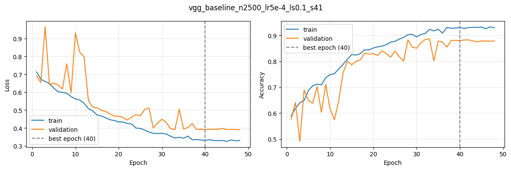
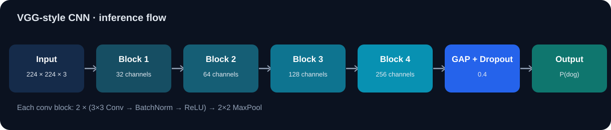
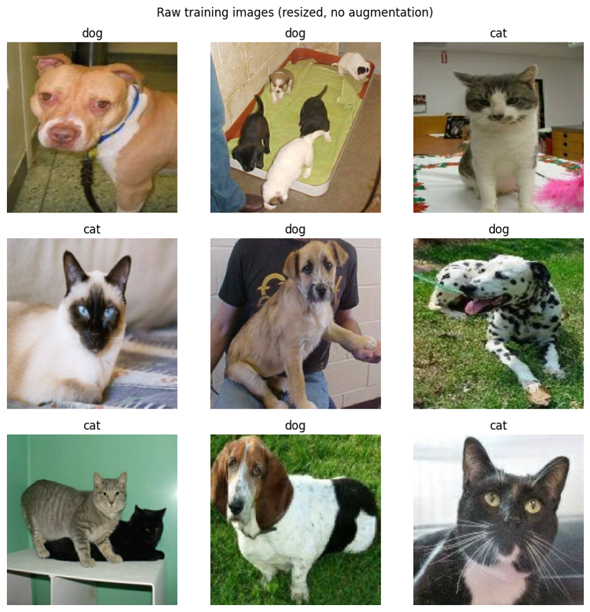
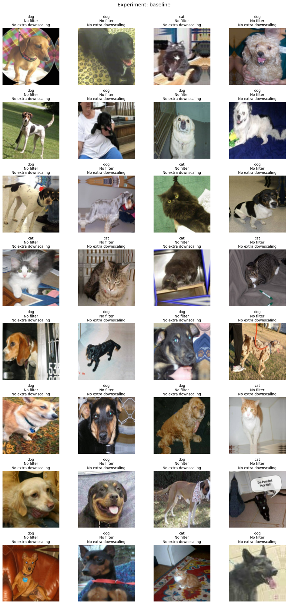

<div align="center">

# 🐾 Dogs vs. Cats · CNN from Scratch

### A VGG-inspired image classifier with a reproducible TensorFlow/Keras training pipeline


**Built and trained a CNN architecture from scratch, with an extensible data pipeline for testing preprocessing and augmentation choices.**

[Results](#-results-at-a-glance) · [Training curves](#-training-behaviour) · [Architecture](#-model-architecture) · [Run](#-getting-started)

</div>

---

## 📊 Results at a glance

<div align="center">

| Validation accuracy | Validation AUC | Model parameters | Best epoch |
|:---:|:---:|:---:|:---:|
| **87.95%** | **0.9548** | **1.18M** | **40** |

</div>

**Experiment:** `vgg_baseline_n2500_lr5e-4_ls0.1` · seed `41` · **5,000** training / **2,000** validation images · **224 × 224** RGB · **41.1 min** training · early stopping after **48 / 50** epochs.

> **Evaluation note:** Results are from one recorded seeded run, not an average across seeds. Accuracy and AUC are measured on the selected validation subset; the unlabeled test set has no reported accuracy in this notebook.

## 📈 Training behaviour



*Training curves extracted directly from the notebook output. The best checkpoint was selected on validation loss (epoch 40), with early stopping and weight restoration.*

## 🧠 Model architecture



This is a **custom VGG-style model**, not a pretrained VGG network. Four convolutional blocks increase feature depth from **32 → 64 → 128 → 256**, each using two `3×3 Conv → BatchNorm → ReLU` layers followed by max pooling. Global average pooling and dropout (`0.4`) feed a single sigmoid output for `P(dog)`.

<details>
<summary><b>Architecture and training details</b></summary>

| Component | Configuration |
|---|---|
| Input | `224 × 224 × 3` RGB |
| Convolutional backbone | 4 blocks, 2 convolutions each |
| Classification head | GlobalAveragePooling2D → Dropout(0.4) → Dense(1, sigmoid) |
| Parameters | 1,175,393 |
| Initializer | He normal |
| Optimizer | AdamW, LR `5e-4`, weight decay `1e-4` |
| Loss | Binary cross-entropy, label smoothing `0.1` |
| Batch size | 32 |
| Training controls | EarlyStopping (patience 8), ReduceLROnPlateau (patience 3), best checkpoint |
| Precision | Mixed float16 on available GPU; float32 output |

The notebook also exposes an optional `Flatten`/dense classification head for architecture comparisons. Its results are **not** represented by the baseline metrics above.

</details>

## 🖼️ Data & preprocessing

<div align="center">


<sub>Sample images displayed by the notebook (from the selected training data).</sub>
</div>

The TensorFlow `tf.data` pipeline loads and resizes RGB images, caches the dataset, shuffles training samples, and prefetches batches. It supports geometric augmentations including **horizontal flips, rotation, zoom, and translation**, plus optional simulated low resolution, median filtering, and Laplacian sharpening.

<details>
<summary><b>See example augmented batch</b></summary>



The image comes from the notebook's **baseline** preview. Optional median/Laplacian/downscaling configurations are available in the code, but the image above is **not** evidence that those alternative experiments were run.

</details>

### Pipeline overview

```text
Training:    Decode → Resize → Cache → Shuffle → Optional filters → Batch → Augment → Normalize
Validation:  Decode → Resize → Cache → Normalize
Test:        Decode → Resize → Cache → Normalize
```

The fixed validation pipeline avoids introducing random training augmentation into evaluation.

## 🛠️ Getting started

**Main notebook:** [`IE4483_CNN.ipynb`](IE4483_CNN.ipynb)  
**Recommended environment:** Google Colab with GPU (recorded run: TensorFlow 2.21.0, Keras 3.13.2).

1. Add the project dataset archive as `MyDrive/IE4483/IE4483.zip` in Google Drive.
2. Open the notebook in Colab and enable a GPU runtime.
3. Adjust the experiment settings in **Section 1 — Setup and Configuration**.
4. Select **Runtime → Run all**.
5. Review the saved checkpoints, training curves, and experiment log in Google Drive.

Expected contents of the extracted archive:

```text
datasets/
├── train/
│   ├── cat/
│   └── dog/
├── val/
│   ├── cat/
│   └── dog/
└── test/
    └── <numeric_image_id>.jpg
```

The notebook samples **2,500 images per class** for training and **1,000 per class** for validation by default, with seeded selection.

### Generate predictions

After training, run:

```python
write_submission(baseline_model)
```

This exports `submission.csv` with `id,label` columns. The function exists in the notebook but **is not invoked automatically** by its training cell.

## 📁 Repository layout

```text
.
├── IE4483_CNN.ipynb
├── README.md
└── assets/
    ├── architecture.svg
    ├── training-curves.png
    ├── dataset-preview.png
    └── augmentation-preview.png
```

The notebook writes its runtime outputs to `MyDrive/IE4483/`, including `results.csv`, `checkpoints/`, and `figures/`.

## 💡 Engineering takeaways

- **Architecture implementation:** constructed the convolutional backbone using Keras layers rather than pretrained weights.
- **Data pipeline design:** separated training augmentation from deterministic validation/test preprocessing.
- **Experiment control:** exposed preprocessing options, seeded subset selection, model checkpointing, and metric logging.
- **Generalization monitoring:** tracked validation loss, accuracy, and AUC rather than training accuracy alone.

## 📌 Scope & limitations

This repository documents the **CNN baseline** and its configurable training pipeline. It does not include the separate Vision Transformer or ResNet50V2 experiments, model deployment to embedded hardware, or measured on-device inference latency. The dataset archive and trained checkpoint are not bundled with this README.

---

<div align="center"><sub>Academic deep-learning project · TensorFlow / Keras · Image classification</sub></div>
